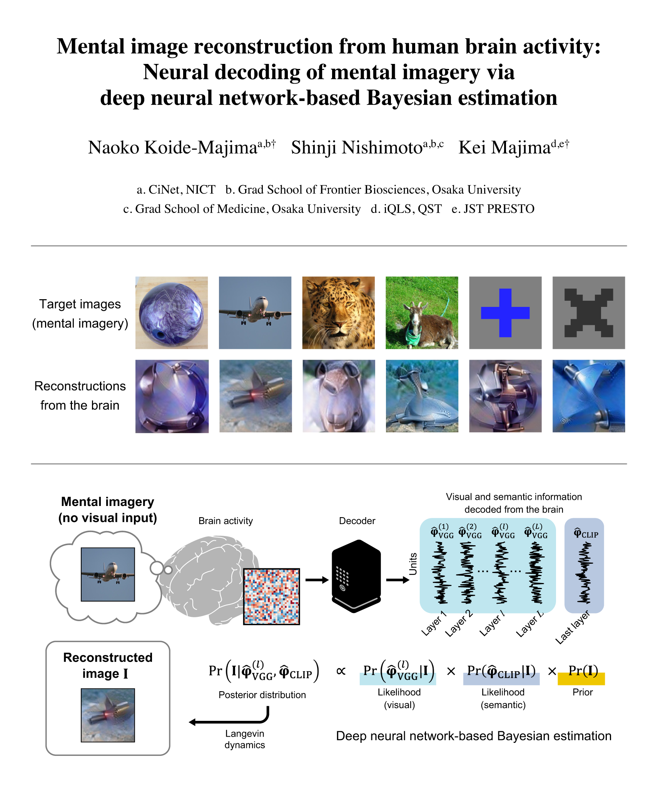
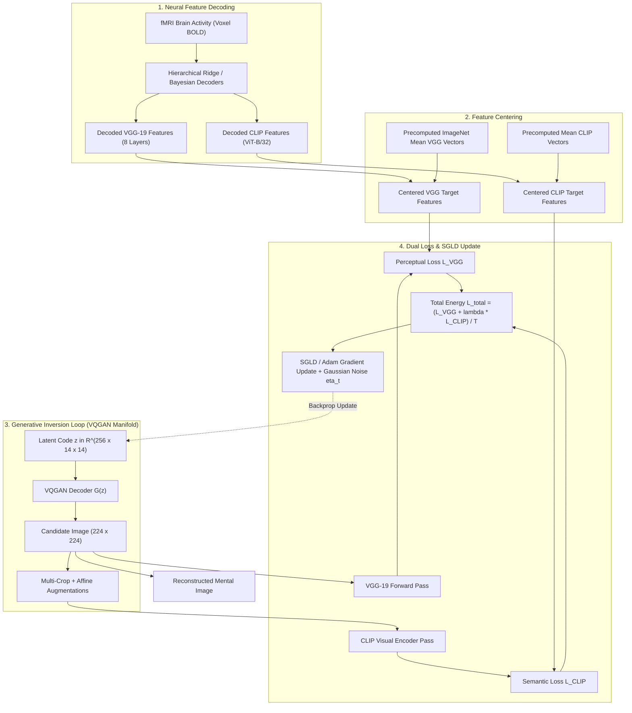

# Mental Image Reconstruction from Human Brain Activity

[](https://www.python.org/)
[](https://pytorch.org/)
[](https://opensource.org/licenses/MIT)
[](https://colab.research.google.com/)

> **Neural Decoding of Mental Imagery via Deep Neural Network-Based Bayesian Estimation**  
> An implementation of a Bayesian optimization framework that decodes voluntary mental imagery from human functional magnetic resonance imaging (fMRI) brain activity and reconstructs the imagined visual stimuli using hierarchical deep neural networks (VGG-19, CLIP) and generative latent priors (VQGAN).

---

<p align="center">
  
</p>
<p align="center">
  <em>Figure 1: Examples of target images imagined by human subjects alongside reconstructions generated from decoded brain activity.</em>
</p>

---

## Table of Contents

- [Overview & Scientific Background](#overview--scientific-background)
- [How It Works](#how-it-works)
  - [Bayesian Inversion Framework](#bayesian-inversion-framework)
  - [Dual-Stream Feature Loss](#dual-stream-feature-loss)
  - [Optimization & Langevin Dynamics](#optimization--langevin-dynamics)
- [System Architecture](#system-architecture)
- [Repository Structure](#repository-structure)
- [Getting Started](#getting-started)
  - [Prerequisites](#prerequisites)
  - [Installation](#installation)
  - [Download Pretrained Models](#download-pretrained-models)
  - [Download Decoded Brain Features](#download-decoded-brain-features)
- [Usage Guide](#usage-guide)
  - [Interactive Demo (Jupyter Notebook)](#interactive-demo-jupyter-notebook)
  - [Programmatic Execution (Python API)](#programmatic-execution-python-api)
- [Configuration Reference](#configuration-reference)
  - [Subjects & Target Imagery](#subjects--target-imagery)
  - [Reconstruction Methods](#reconstruction-methods)
- [Key Findings](#key-findings)
- [Related Works & Dependencies](#related-works--dependencies)
- [License](#license)

---

## Overview & Scientific Background

Externalizing the visual content of voluntary **mental imagery**—what a person visualizes in their "mind's eye"—is a fundamental goal of cognitive neuroscience and neurotechnology. While neural decoding has achieved remarkable success in reconstructing images during *active visual perception* (seen stimuli), decoding *mental imagery* presents steep challenges:

1. **Signal Disparity:** Mental imagery activates early visual areas (e.g., V1–V3) much more weakly than bottom-up sensory perception.
2. **Top-Down Semantic Dominance:** Imagined content relies heavily on feedback projections from high-order visual, parietal, and frontal regions encoding abstract semantics.
3. **Complex Posterior Landscape:** The mapping between high-dimensional image space and noisy, lower-resolution fMRI voxel patterns contains numerous local optima.

This project addresses these challenges by employing a **deep neural network-based Bayesian estimation framework**. By coupling a generative image prior (VQGAN) with both hierarchical perceptual representations (VGG-19) and vision-language semantic embeddings (CLIP), the system reconstructs both simple geometric shapes and rich natural object categories imagined by human subjects.

---

## How It Works

### Bayesian Inversion Framework

The reconstruction problem is cast as maximizing the posterior probability of a natural image $x = G(z)$ given decoded brain features $\mathbf{y}$:

$$p(z \mid \mathbf{y}) \propto p(\mathbf{y} \mid z) \, p(z)$$

- **Generative Image Prior $p(z)$:** Provided by a pretrained **VQGAN** (Vector Quantized GAN) trained on ImageNet. Instead of optimizing pixel values directly, optimization is performed in the compressed latent code space $z \in \mathbb{R}^{256 \times 14 \times 14}$, ensuring the output remains on the manifold of natural images.
- **Likelihood Model $p(\mathbf{y} \mid z)$:** Evaluates the correspondence between features extracted from the synthesized candidate image $G(z)$ and the features predicted from human fMRI activity.

### Dual-Stream Feature Loss

The energy function (loss) balances low-to-mid-level structural details with high-level semantic identity:

$$\mathcal{L}_{\text{total}}(z) = \frac{\mathcal{L}_{\text{VGG}}(z) + \lambda_{\text{CLIP}} \, \mathcal{L}_{\text{CLIP}}(z)}{T}$$

#### 1. Perceptual Structural Loss ($\mathcal{L}_{\text{VGG}}$)
Features are extracted across 8 hierarchical layers of VGG-19 (`features[2]`, `features[7]`, `features[16]`, `features[25]`, `features[34]`, `classifier[0]`, `classifier[3]`, `classifier[6]`):

$$\mathcal{L}_{\text{VGG}} = - \sum_{l=1}^{L} w_l \cdot \text{CosineSimilarity}\left(f_{\text{VGG}}^l(G(z)) - \mu_{\text{VGG}}^l, \; \mathbf{y}_{\text{VGG}}^l - \mu_{\text{VGG}}^l\right)$$

where $\mu_{\text{VGG}}^l$ is the dataset mean feature vector for layer $l$ (feature centering to eliminate bias), and $w_l$ is the layer weight.

#### 2. Semantic Alignment Loss ($\mathcal{L}_{\text{CLIP}}$)
To ensure robustness to spatial jitter, multi-crop augmented patches (with random affine transformations and Gaussian noise) are processed by OpenAI's CLIP (ViT-B/32):

$$\mathcal{L}_{\text{CLIP}} = - \sum_{m} \alpha_m \cdot \text{CosineSimilarity}\left(f_{\text{CLIP}}^m(\text{crops}(G(z))) - \mu_{\text{CLIP}}^m, \; \mathbf{y}_{\text{CLIP}}^m - \mu_{\text{CLIP}}^m\right)$$

### Optimization & Langevin Dynamics

To avoid entrapment in bad local minima inherent to complex feature inversion, the pipeline supports **Stochastic Gradient Langevin Dynamics (SGLD)**:

$$z_{t+1} = z_t - \frac{\epsilon_t}{T} \nabla_z \mathcal{L}(z_t) + \boldsymbol{\eta}_t, \quad \boldsymbol{\eta}_t \sim \mathcal{N}\left(0, \, \epsilon_t \mathbf{I}\right)$$

where the learning rate decays polynomially: $\epsilon_t = a \, (b + t)^{-\gamma}$.

Three reconstruction strategies are provided:
- **`original` (Recommended):** A two-stage approach combining 1,000 steps of deterministic Adam optimization followed by 500 steps of SGLD exploration to refine high-frequency details.
- **`Langevin`:** Pure Stochastic Gradient Langevin Dynamics initialized from random or uniform noise canvas.
- **`withoutLangevin`:** Deterministic gradient descent using Adam/AdamW optimizer.

---

## System Architecture



---

## Repository Structure

```
mental_img_recon/
├── config.yaml               # Model layers, paths, and reconstruction hyperparameters
├── demo_params.yaml          # Subject IDs, target imagery definitions, and paths
├── model_loading.py          # Loaders for VQGAN (Taming Transformers), VGG19, and CLIP
├── recon_func.py             # Core reconstruction engine (imageRecon class, losses, SGLD)
├── recon_utils.py            # Feature loader, progress plotter, and pipeline runner
├── recon_demo_20240628.ipynb # End-to-end interactive demo notebook (Google Colab ready)
├── requirements.txt          # Python package dependencies
├── .gitignore                # Rules for excluding artifacts, virtualenvs, and data
└── ref_images/
    ├── eyecatch__mental_im_recon__+_x_ver.png # Comparison banner (targets vs reconstructions)
    ├── target_images.jpg                      # Visual montage of all 25 target images
    ├── target_images.pkl                      # Target image matrices and bounding coordinates
    └── uniformGray.tiff                       # Baseline neutral canvas for initialization
```

---

## Getting Started

### Prerequisites

- Python 3.8 or higher
- NVIDIA GPU with at least 8 GB VRAM (CUDA 11.3+ recommended)
- Git and `wget` / `curl`

### Installation

1. **Clone this repository:**
   ```bash
   git clone https://github.com/Swachhith/Reconstructing-Images-from-FMRI-data.git
   cd Reconstructing-Images-from-FMRI-data
   ```

2. **Create and activate a virtual environment:**
   ```bash
   python -m venv venv
   # On Linux/macOS:
   source venv/bin/activate
   # On Windows:
   venv\Scripts\activate
   ```

3. **Install core dependencies:**
   ```bash
   pip install -r requirements.txt
   ```

4. **Install OpenAI CLIP:**
   ```bash
   pip install git+https://github.com/openai/CLIP.git
   ```

5. **Install Taming Transformers (VQGAN):**
   ```bash
   git clone https://github.com/CompVis/taming-transformers
   cd taming-transformers
   pip install -e .
   cd ..
   ```

### Download Pretrained Models

Download the ImageNet VQGAN ($f=16$, 1024 codebook entries) checkpoint and model architecture:

```bash
mkdir -p taming-transformers/logs/vqgan_imagenet_f16_1024/checkpoints
mkdir -p taming-transformers/logs/vqgan_imagenet_f16_1024/configs

# Download weights (~900 MB)
wget "https://heibox.uni-heidelberg.de/f/140747ba53464f49b476/?dl=1" \
     -O taming-transformers/logs/vqgan_imagenet_f16_1024/checkpoints/last.ckpt

# Download model configuration YAML
wget "https://heibox.uni-heidelberg.de/f/6ecf2af6c658432c8298/?dl=1" \
     -O taming-transformers/logs/vqgan_imagenet_f16_1024/configs/model.yaml
```

*(Note for PyTorch 2.x users: in `taming/data/utils.py`, replace `from torch._six import string_classes` with `string_classes = str`).*

### Download Decoded Brain Features

The extracted and decoded fMRI features for subjects `S01`, `S02`, and `S03` are hosted on Google Drive:

```python
import gdown
import tarfile

file_id = '1Q7TVsVbASMqnDYfFjFzo2SV6njExu8qq'
download_url = f'https://drive.google.com/uc?id={file_id}'
gdown.download(download_url, 'downloaded_file.tar.gz', quiet=False)

with tarfile.open('downloaded_file.tar.gz', 'r:gz') as tar:
    tar.extractall(path='.')
```

This extracts:
- `features/decoded_features/`: Predicted DNN features for each subject and target image.
- `features/meanDNNfeature/`: Mean feature vectors ($\mu$) across ImageNet for feature centering.

---

## Usage Guide

### Interactive Demo (Jupyter Notebook)

The fastest way to explore mental image reconstruction is using the included Jupyter notebook:

```bash
jupyter notebook recon_demo_20240628.ipynb
```

The notebook guides you through:
1. Environment setup and package imports.
2. Automated model downloading and weight caching.
3. Choosing a subject (`S01`, `S02`, or `S03`) and targets (IDs `0`–`24`).
4. Running the iterative reconstruction with real-time matplotlib visual feedback.

### Programmatic Execution (Python API)

You can run reconstructions directly from a Python script:

```python
import yaml
import torch
import model_loading
import recon_utils as utils

# 1. Load Configurations
with open('demo_params.yaml', 'rb') as f:
    prm_demo = yaml.safe_load(f)
with open('config.yaml', 'rb') as f:
    dt_cfg = yaml.safe_load(f)

device = torch.device("cuda:0" if torch.cuda.is_available() else "cpu")

# 2. Load Models
dir_taming = dt_cfg['file_path']['taming_transformer_dir']
cfg_vqgan = model_loading.load_config(f"{dir_taming}/logs/vqgan_imagenet_f16_1024/configs/model.yaml")
vqgan = model_loading.load_vqgan(
    cfg_vqgan, 
    ckpt_path=f"{dir_taming}/logs/vqgan_imagenet_f16_1024/checkpoints/last.ckpt"
).to(device)

vgg, _ = model_loading.load_VGG_model(device)

clip_types = dt_cfg["models"]["CLIP"]["modeltypes"]
clip_models, _ = model_loading.load_CLIP_model(clip_types, device)
clip_weights = dt_cfg["models"]["CLIP"]["modelcoefs"]

# 3. Select Subject & Target Imagery
subject = 'S02'          # 'S01', 'S02', or 'S03'
target_ids = [21, 20, 18] # 21: Bowling ball, 20: Airplane, 18: Leopard
recon_method = 'original' # 'original', 'Langevin', or 'withoutLangevin'

# 4. Run Reconstruction
utils.start_reconstruction(
    subject=subject,
    targetID_list=target_ids,
    reconMethod=recon_method,
    dt_cfg=dt_cfg,
    prm_demo=prm_demo,
    CLIPmodel_=clip_models,
    VGGmodel_=vgg,
    CLIPmodelWeight_=clip_weights,
    VQGANmodel1024=vqgan,
    DEVICE=device
)
```

---

## Configuration Reference

### Subjects & Target Imagery

The dataset provides decoded mental imagery for three human subjects: `S01`, `S02`, and `S03`.

The targets comprise 25 distinct imagery stimuli (indices `0` through `24`):

| Target Index | Category | Stimulus Name | Description |
| :---: | :---: | :---: | :---: |
| **0 – 2** | Geometric Symbol | `red_smallring`, `red_+`, `red_X` | Red circle, cross, and diagonal X |
| **3 – 5** | Geometric Symbol | `green_smallring`, `green_+`, `green_X` | Green circle, cross, and diagonal X |
| **6 – 8** | Geometric Symbol | `blue_smallring`, `blue_+`, `blue_X` | Blue circle, cross, and diagonal X |
| **9 – 11** | Geometric Symbol | `white_smallring`, `white_+`, `white_X` | White circle, cross, and diagonal X |
| **12 – 14** | Geometric Symbol | `black_smallring`, `black_+`, `black_X` | Black circle, cross, and diagonal X |
| **15** | Control | `fixation` | Neutral central fixation cross |
| **16 – 19** | Natural Animal | ImageNet Natural Animals | Leopard, Goat, Fish, etc. |
| **20 – 24** | Natural Artifact | ImageNet Natural Artifacts | Airplane, Bowling Ball, Locomotive, etc. |

### Reconstruction Methods

All hyperparameter profiles are defined in `config.yaml`:

| Method | Optimizer | Repetitions | SGLD Annealing Parameters | Notes |
| :--- | :--- | :---: | :--- | :--- |
| **`original`** | Adam $\rightarrow$ SGLD | $1000 + 500$ | $\gamma=0.055, \, a=0.00015, \, b=0.15, \, T=10^{-6}$ | Best overall quality; smooth initial convergence followed by detail refinement. |
| **`withoutLangevin`** | Adam | $1000$ | N/A | Fast convergence; susceptible to minor edge blur or local minima. |
| **`Langevin`** | Pure SGLD | $1000$ | $\gamma=0.1, \, a=1.0, \, b=1.0, \, T=10^{-4}$ | Stochastic posterior sampling from uniform noise canvas. |

---

## Key Findings

1. **The "Sharpening Effect" of Mental Imagery:**  
   Reconstructions of imagined geometric shapes (e.g., crosses and rings) consistently display higher edge contrast and sharper line boundaries than reconstructions from perception scans. This reflects the brain's top-down visual priors enhancing salient boundaries during voluntary imagination.
2. **Complementarity of VGG and CLIP:**  
   VGG-19 features provide spatial structure and color layout, while CLIP ensures that categorical semantic semantics (e.g., distinguishing a bowling ball from an aircraft) are preserved even when low-level signal quality is degraded.
3. **Generative Prior Efficacy:**  
   Restricting optimization to the latent manifold of VQGAN prevents unconstrained high-frequency noise artifacts common to classical pixel-space pixel-inversion methods.

---

## Related Works & Dependencies

- **VQGAN:** Esser et al., *"Taming Transformers for High-Resolution Image Synthesis"*, CVPR 2021.
- **CLIP:** Radford et al., *"Learning Transferable Visual Models From Natural Language Supervision"*, ICML 2021.
- **VGG-19:** Simonyan & Zisserman, *"Very Deep Convolutional Networks for Large-Scale Image Recognition"*, ICLR 2015.

---

## License

This project is licensed under the [MIT License](LICENSE) - see the LICENSE file for details.
